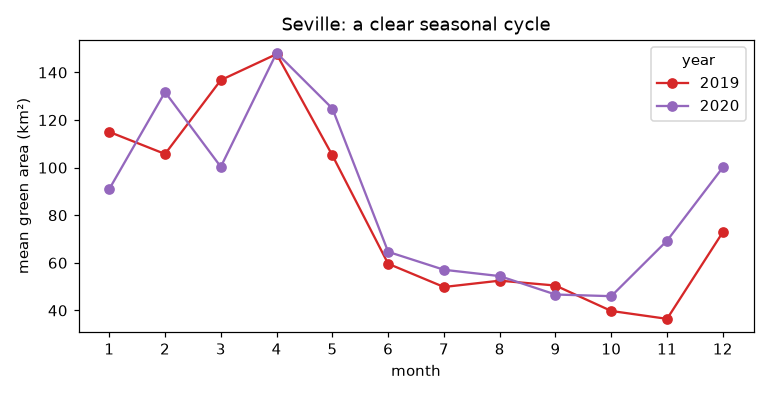
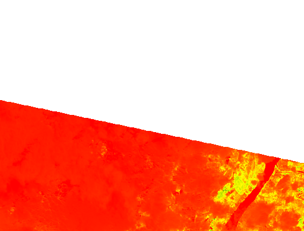
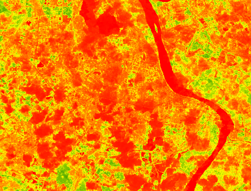
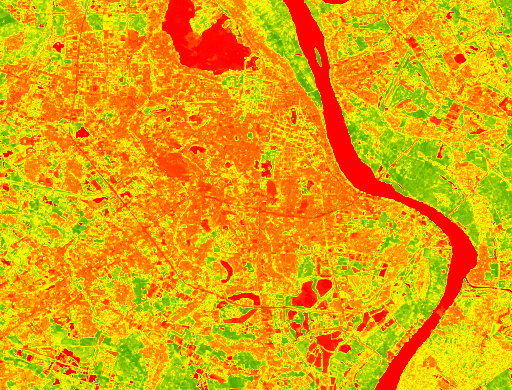
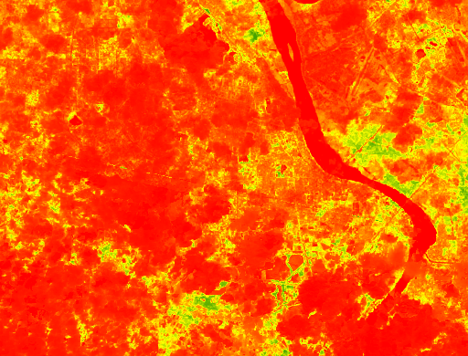

# Green Space in Vietnamese Cities, Seen from Space

How much of a city is green, and does that change through the year the way you'd expect? This project measures **green area** from satellite images (Landsat-8 and Sentinel-2, 2016-2021) in Hanoi, Ho Chi Minh City (Saigon), their outskirts and Khanh Hoa province, and compares them with **Seville, Spain**, a clear-sky city used as a reference.

It started as a high school research project in spring 2024. In October 2026 I reorganized the code and data into this repo. The original findings are kept as they were, and [what I changed](#what-i-changed-in-this-version) is listed below.



*Seville (the reference): green area climbs from January to about May, falls through the summer and recovers in late winter, and 2019 and 2020 agree.*

## How it works

1. **Collect** (`src/collect_green_area.py`): for each satellite image of a region in Google Earth Engine, compute NDVI (a vegetation index from the red and near-infrared bands), count pixels with NDVI > 0.3 as "green", and record the image's cloud cover. The result is one row per image: city, month, year, date, cloud cover, green area (km²).
2. **Clean** (`src/clean_data.py`): keep images with at most 50% cloud, drop images with a green area under 1, and remove outliers per city, month and year (Q1 − 1.5·IQR to Q3 + 1.5·IQR).
3. **Analyze**: look at the average green area by month and year in each region. Originally in Tableau; now in [`notebooks/analysis.ipynb`](notebooks/analysis.ipynb).

Hanoi's land cover in four seasons (NDVI, red = little vegetation, green = lots):

| Winter | Spring | Summer | Fall |
|---|---|---|---|
|  |  |  |  |

## Original findings

These are the conclusions of the 2024 study, unchanged:

- **Seville behaves as expected.** Green area grows rapidly from January to May, falls steeply in summer, and recovers toward the end of winter, smoothly and similarly in both years. That gave me confidence that the method works.
- **The Vietnamese regions do not.** Across all five regions there was no consistent seasonal pattern from year to year, unlike Seville.
- **Saigon** (city and outskirts) showed large month-to-month fluctuations, and no single year stood out as higher or lower.
- **Hanoi city** showed significant variability, with dramatic peaks and dips, and the outskirts fluctuated less.
- **Khanh Hoa province and outskirts/rural areas** looked relatively stable, with more natural seasonal cycles, which I suggested could be due to less human activity there.
- **Likely reasons for the irregularity:** Vietnam's tropical climate (humid, with frequent rain), heavy cloud cover that corrupts the satellite measurements, and urban development in the two big cities.
- **Limitations I noted:** clouds hide the ground (Landsat's lower resolution makes this worse), water or bare soil can be mistaken for vegetation, small patches of vegetation are missed, and cloudy months can leave gaps or create false dips. Satellites only revisit every 5 days (Sentinel-2) or 16 days (Landsat-8).
- **Future work I proposed:** cloud-robust image processing, other regions with similar climates for comparison, and extra data such as ground observations, temperature and rainfall.

## What I changed in this version

Nothing in the data or the conclusions above changed. What changed is how it's organized and checked:

- **One collection script** (`collect_green_area.py`) replaces separate near-duplicate Landsat and Sentinel scripts. The logic is the same: same NDVI threshold, bands, scales and cloud properties.
- **A cleaning script that reproduces my cleaned data exactly.** I had cleaned the files with a script that had my computer's folders written into it. The new one takes folder arguments, and re-running it on `data/raw/` gives all 11 cleaned files in `data/cleaned/` with identical rows and values.
- **A notebook instead of Tableau.** The dashboards can't be shared as code; the notebook redraws the seasonal views from the data in this repo.
- **Two added checks**, marked *(added)* in the notebook, which are new in this version and not part of the original study:
  - *Is the seasonal pattern consistent?* Average year-to-year correlation of each region's monthly profile: Seville 0.85, but only Hanoi outskirts comes close among the Vietnamese regions (0.75 in Sentinel-2 data), Hanoi city about 0.35 to 0.40, and Saigon and Khanh Hoa low (between −0.04 and 0.26). This supports the finding that the Vietnamese regions lack Seville's cycle, but **only partly supports** the idea that outskirts and Khanh Hoa are steadier: true for Hanoi outskirts, not for Saigon outskirts or Khanh Hoa.
  - *Does cloud cover explain the noise?* In the raw data, measured green area falls steadily as cloud cover rises, in every region including Seville (Hanoi city: about 123 km² on the clearest images vs about 9 km² on the cloudiest). The median image is 77% cloud in Hanoi city but only 6% in Seville, which backs up the paper's main explanation.
- **Tidied names and details:** consistent file names (`<region>_<satellite>.csv`; I fixed "saison" → "saigon" in one name); my Google Cloud project ID is replaced by an environment variable; the units are square kilometres (the collection code converts to km²; the paper's text called them hectares).
- **Not included:** the paper itself (it names my school and a teacher), the Tableau workbooks, and the polygons for four of the six regions, which were drawn interactively in Earth Engine and not saved. Their results are in `data/`.

## Data

Satellite imagery is from USGS/NASA Landsat-8 and ESA Copernicus Sentinel-2, accessed through Google Earth Engine. `data/raw/` has one file per region and satellite, with about 200 to 1,600 images each. Quirks, kept as they were: Seville's satellite label reads "Setinel-2" (a typo), the cleaned files label city centres and outskirts as "Hanoi C", "Hanoi O" and so on, and Seville only has two years of data (2019-2020).

## Run it

```bash
pip install -r requirements.txt
jupyter notebook notebooks/analysis.ipynb       # redraw the figures from data/
python src/clean_data.py                         # re-clean data/raw -> data/cleaned
```

Re-collecting from satellite data needs a Google Earth Engine account (`earthengine authenticate`, then `export EE_PROJECT=<your project>` and `python src/collect_green_area.py --region saigon_outskirts --satellite sentinel2`). Only two region boundaries are saved in [`src/regions.py`](src/regions.py), and Google has since deprecated the Landsat Collection 1 data set this used, so rerunning needs small updates (see the note in the script).

## Timeline

| When | What |
|---|---|
| Spring 2024 | The original study, done independently with a teacher facilitating: data collection in Earth Engine, cleaning, Tableau dashboards, and a short paper |
| October 2026 | Reorganized into this repo: consolidated scripts, a reproducible cleaning step, a notebook with two added checks, and this write-up |

## License

MIT. Satellite data © USGS/NASA (Landsat) and ESA (Copernicus Sentinel).
